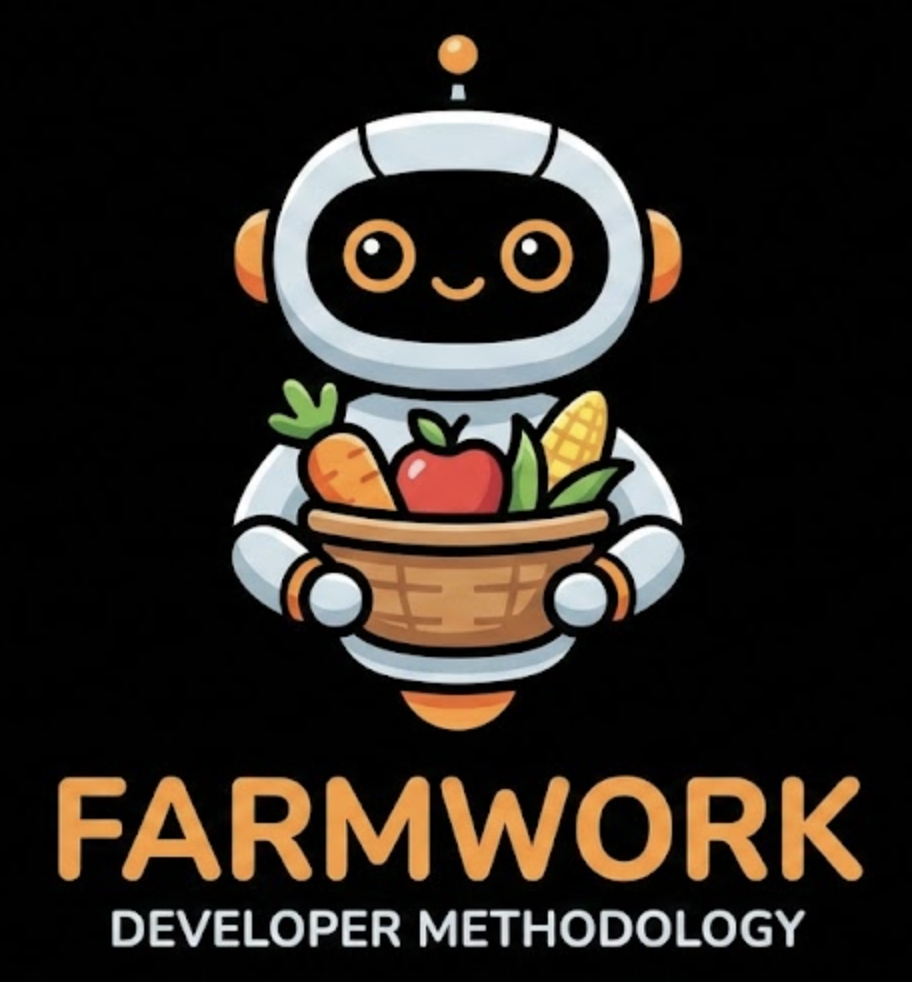

> **Farmwork v3** — Agent-first engineering standards, an MCP server any AI agent can use natively, and a zero-server Local Farm Viewer for your Markdown docs and checklists.

Built for **real projects beyond prototypes** where you want Claude Code, Gemini CLI, Codex, Cursor, or Antigravity to follow consistent planning, auditing, checklist, and quality-gate standards without prompt drift or hosted dashboards.

---

## Quick Start

```bash
npm install -g farmwork
```

Initialize any repo (Node/TS, Ruby/Rails, Python, Rust, or Go):

```bash
cd your-project
farmwork init
```

Open the **Local Farm Viewer** for one project or a folder full of projects:

```bash
farmwork view            # view current project
farmwork view ~/Work     # view all local Farmwork projects in ~/Work
```

---

## Connect Any AI Agent via MCP

`farmwork init` writes a `.mcp.json` automatically so Claude Code, Cursor, and Antigravity discover Farmwork out of the box.

To register Farmwork globally for any MCP-capable agent:

```json
{
  "mcpServers": {
    "farmwork": {
      "command": "npx",
      "args": ["-y", "farmwork", "mcp"]
    }
  }
}
```

Or in **Claude Code**:

```bash
claude mcp add farmwork -- npx -y farmwork mcp
```

Or in **Gemini CLI** (`~/.gemini/settings.json`) / **Codex** (`~/.codex/config.toml`): point an MCP server entry at `npx -y farmwork mcp` (or `farmwork mcp` if installed globally).

---

## What the MCP Server Gives Your Agents

### 8 Lean Deterministic Tools

| Tool | What It Does |
|---|---|
| `farmwork_status` | Deterministic health score (0–10), pillar scores, Beads summary, Justfile recipes, stack, test count, gates, checklist %, garden, plans, git state |
| `farmwork_audit` | Age Idea Garden, scan code/state-machine hotspots & refresh `_AUDIT/FARMHOUSE.md`, OR run/save lazy pillar audits (`security`, `performance`, `accessibility`, `code-quality`) |
| `farmwork_gates` | Run detected `lint`, `test`, `build`, and local `security` secrets check, recording commit SHA so gates detect staleness |
| `farmwork_beads` | **For agents:** granular task & dependency execution tracker via [Beads](https://beads.gascity.com/) (`status`, `ready`, `list`, `create`, `claim`, `update`, `close`, `dep`, `sync`, `init`) |
| `farmwork_just` | Inspect, run, or generate a maintained [Justfile](https://just.systems/man/en/) (`list`, `run`, `init`) |
| `farmwork_checklist` | **For humans:** concise big-picture checklist (<=30 items: standards, big plans, future roadmap) with `list`, `complete`, `pending`, `skip`, `add`, and `link` (connects to Beads) |
| `farmwork_garden` | `list`, `plant`, or `compost` pre-plan ideas in `_AUDIT/GARDEN.md` (lazily creates `_AUDIT/COMPOST.md`) |
| `farmwork_plan` | `list`, `create` (adds one concise big-plan item to `_AUDIT/CHECKLIST.md`), `to-beads` (breaks steps into granular Beads tasks & links the epic back to the checklist), or `complete` |

### 6 Live Resources
- `farmwork://standards` — Universal agent engineering standards
- `farmwork://farmhouse` — `_AUDIT/FARMHOUSE.md`
- `farmwork://checklist` — `_AUDIT/CHECKLIST.md`
- `farmwork://garden` — `_AUDIT/GARDEN.md`
- `farmwork://compost` — `_AUDIT/COMPOST.md`
- `farmwork://justfile` — Maintained `justfile` recipes

### 7 Workflow Prompts
`audit`, `inspect`, `security`, `performance`, `plan`, `new-ideas`, and `ship` — exposed natively via MCP so you never copy-paste slash-command files across tools.

---

## Checklists vs. Beads (Humans vs. Agents)

Farmwork keeps human planning and agent execution cleanly separated:

- **Checklists (`_AUDIT/CHECKLIST.md`) are for humans** — concise big-picture standards, **big plans**, and **future plans** (`## Big Plans & Future Roadmap`, kept <=30 items so you can scan them at a glance).
- **Beads (`.beads/`) is for agents** — granular task breakdowns, subtasks, blockers, and execution tracking (`bd ready` → claim → close → `bd sync`).
- **Connected end-to-end:** Creating a plan adds one concise big-plan item to `_AUDIT/CHECKLIST.md`; running `to-beads` creates the Beads epic + granular child tasks and attaches ``(beads: `<epic-id>`)`` to that checklist item so you can jump straight from a big plan to its underlying agent work in Markdown or the Local Viewer. Closing that epic in Beads checks the big-plan item off automatically.
- **Concise by enforcement:** `farmwork_checklist add` is refused once the checklist reaches its cap (default 30, `limits.maxChecklistItems` in `.farmwork.json`), and `farmwork doctor` flags bloat — granular work goes to Beads.
- **Roadmap doesn't cost points:** Pending big plans are tracked separately (`Big Plans` in `farmwork status` / `FARMHOUSE.md`) and never lower the health score; only standards count.

---

## Repo Structure

```text
your-project/
├── justfile               # Maintained command recipes (`just --list`, `just check`, `just ready`)
├── .beads/                # Git-backed Beads task & dependency graph (`bd ready`, `bd sync`)
├── .farmwork.json         # Manifest: detected stack + lint/test/build commands
├── .mcp.json              # Auto-wires the Farmwork MCP server
├── AGENTS.md              # Lean universal instructions for any AI agent
├── CLAUDE.md              # Lean pointer to AGENTS.md + MCP
├── _AUDIT/
│   ├── FARMHOUSE.md       # Deterministic health report & audit history
│   ├── CHECKLIST.md       # Stack-aware living standards ([x], [ ], [-] skip)
│   └── GARDEN.md          # Pre-plan ideas with natural 45d/60d aging (COMPOST & pillars created on demand)
└── _PLANS/
    └── FEATURE_NAME.md    # Plan-before-implement specs
```

---

## CLI Reference

```bash
farmwork init [-f] [-y] [--reinstall] [--npx] [--no-justfile] [--no-beads]
farmwork mcp [--cwd <path>]                               # Run MCP server over stdio
farmwork view [path] [-p 4174]                            # Open Local Farm Viewer (1 repo or folder of repos)
farmwork status [--json]                                  # Deterministic health score, Beads & Justfile summary
farmwork audit [--json]                                   # Refresh FARMHOUSE.md & tend Idea Garden
farmwork gates [--only lint,test,build,security]          # Run quality & security gates
farmwork security [--skip-deps] [--json]                  # Deterministic secrets & dependency vulnerability scan
farmwork beads [--init] [--prefix <p>] [--json]           # Show Beads summary + ready unblocked work
farmwork just [recipe] [--init] [--force] [--json]        # List recipes, run a recipe, or generate starter justfile
farmwork doctor [--json]                                  # Diagnose configuration issues
```

---

## Past Farmwork Projects (v1 / v2)

Farmwork v3 **never auto-updates or modifies past Farmwork v1/v2 projects**.
- `farmwork view ~/Work` opens legacy repos in **read-only mode** so you can browse their docs without risking accidental edits.
- `farmwork init`, `farmwork audit`, and mutating MCP tools refuse to modify legacy v1/v2 repos.
- To explicitly move an older project to v3, run **`farmwork init --reinstall`** inside that repo (replaces `.farmwork.json`, `AGENTS.md`, `CLAUDE.md`, and `_AUDIT/FARMHOUSE.md`, safely merges `.mcp.json`, and preserves `_PLANS/`, `GARDEN.md`, and `COMPOST.md`).

---

## What's New in v3.3.0

- **State Machine Auditing Built Into Audits:** `farmwork audit`, `farmwork doctor`, `farmwork_audit` (`code-quality`), and the Local Viewer now detect implicit state machines (boolean flag explosions like `isLoading`/`isSaving`/`isError`, loose status string mutations without transition guards) and recommend **native language constructs first** (TS discriminated unions, Rails `enum` + guarded transitions, Rust/Python/Go enums) — no state-machine library required.
- **Anti-Rot & Context Hygiene:** Flags oversized monolith files (>700 lines), stray debug breakpoints, bloated or stale `AGENTS.md` files (broken file paths or >180 lines), and `justfile` recipe drift against configured gates.
- **Honest Gate Staleness:** `farmwork gates` records the verified commit SHA; landing new code commits without re-running gates decays the quality-gate health score until re-verified.
- **Plan → Beads Graduation:** Turn any `_PLANS/*.md` spec into a Beads epic + child tasks with one click or `farmwork_plan` (`action: "to-beads"`).
- **Hardened & Modular Architecture:** Split `src/core/` and `src/viewer/` into focused modules (<650 lines each), added strict CSP + CSRF `Origin` checks and WebP asset caching to the Local Viewer, and upgraded WCAG 2.1 AA semantics and keyboard focus.

---

## Local Development & Architecture

```bash
git clone https://github.com/wynterjones/farmwork.git
cd farmwork
npm install
npm run lint     # Syntax check + state-machine/monolith/debug hygiene scan
npm test         # Run node:test suite across core, MCP, scanners, Beads/Just, and Viewer
npm run build    # Verify package version, CLI entrypoint, and WebP assets
just check       # Run all gates via maintained justfile
```

Architecture layout:
- `bin/farmwork.js` — CLI entrypoint (`init`, `mcp`, `view`, `status`, `audit`, `gates`, `security`, `beads`, `just`, `doctor`)
- `src/core/` — Modular engine (`shared`, `detect`, `checklist`, `markdown`, `tooling`, `scanners`, `audit`, `init`) re-exported via `src/core.js`
- `src/viewer/` — Zero-dependency Local Farm Viewer (HTTP server in `src/viewer.js`, styles, explicit client route state machine, accessible views/tabs)
- `src/mcp.js` — Stdio MCP server exposing 8 deterministic tools, 6 live resources, and 7 workflow prompts

---

## License

MIT · Created by [Wynter Jones](https://wynter.ai) · [farmwork.dev](https://farmwork.dev)
